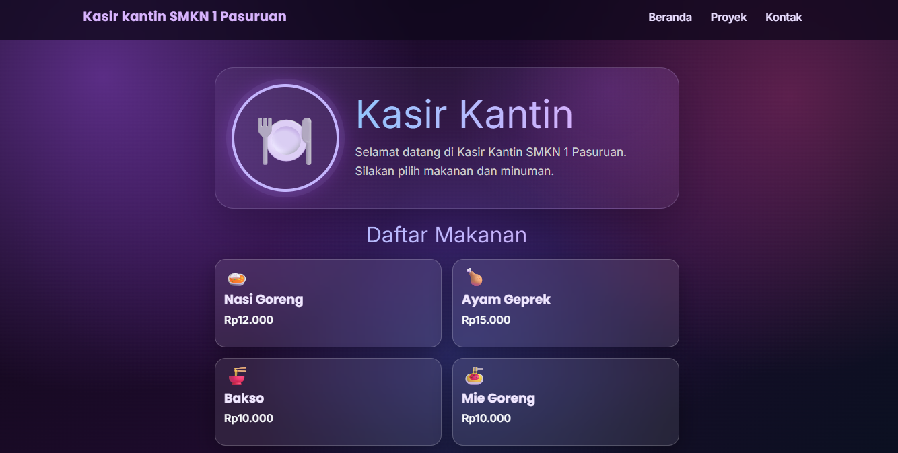

# 🍽️ KASIR KANTIN SMKN 1 PASURUAN

## 📌 Deskripsi
Program Kasir Kantin SMKN 1 Pasuruan merupakan
program sederhana menggunakan JavaScript untuk
menghitung total harga makanan dan minuman,
pembayaran, kekurangan uang, serta kembalian.

## 🍛 Daftar Makanan
1. Nasi Goreng - Rp12.000
2. Ayam Geprek - Rp15.000
3. Bakso - Rp10.000
4. Mie Goreng - Rp10.000

## 🥤 Daftar Minuman
1. Es Teh - Rp4.000
2. Es Jeruk - Rp5.000
3. Es Cokelat - Rp6.000
6. Air Mineral - Rp3.000

## ✨ Fitur Program
- Menampilkan daftar menu.
- Menghitung total harga.
- Menghitung uang pembayaran.
- Mengecek kekurangan uang.
- Menghitung uang kembalian.
- Menampilkan struk pembelian.

## 🛠️ Teknologi
- HTML
- CSS
- JavaScript

## ▶️ Cara Menjalankan
1. Buka folder project di VS Code.
2. Buka file index.html.
3. Jalankan menggunakan Live Server.
4. Lihat hasil program di browser.

## 👨‍💻 Pembuat
Nama: Rahmat Bintang T.K
Sekolah: SMKN 1 Pasuruan
Jurusan: Rekayasa Perangkat Lunak