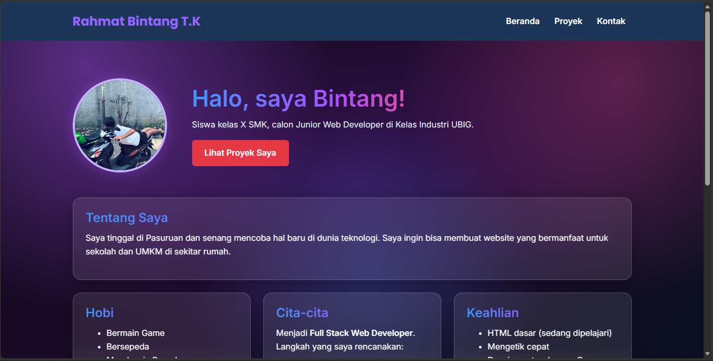

# Portofolio Rahmat Bintang Tegar K
Website portofolio pribadi yang saya buat di Kelas Industri UBIG
(Paket 1, Minggu 01 sampai 07).
Website ini tampil rapi di ponsel, tablet, dan laptop.

## Tampilan

## Fitur
- Halaman *Beranda* berisi profil, hobi, cita-cita, jadwal belajar, dan keahlian dari data JavaScript
- Halaman *Proyek* menampilkan enam proyek dinamis dengan filter HTML, CSS, dan JavaScript
- Halaman *Kontak* berisi form dengan penghitung karakter pesan (maksimal 300)
- Mode gelap tersedia di halaman Beranda, Proyek, dan Kontak
- Tampilan responsif dengan Flexbox dan media query

## Teknologi
- HTML5
- CSS3 (Flexbox dan media query)
- Git dan GitHub
- VS Code dan Live Server

## Tautan
- Website: 
- Dibuat oleh Rahmat Bintang T.K, SMKN 1 Pasuruan